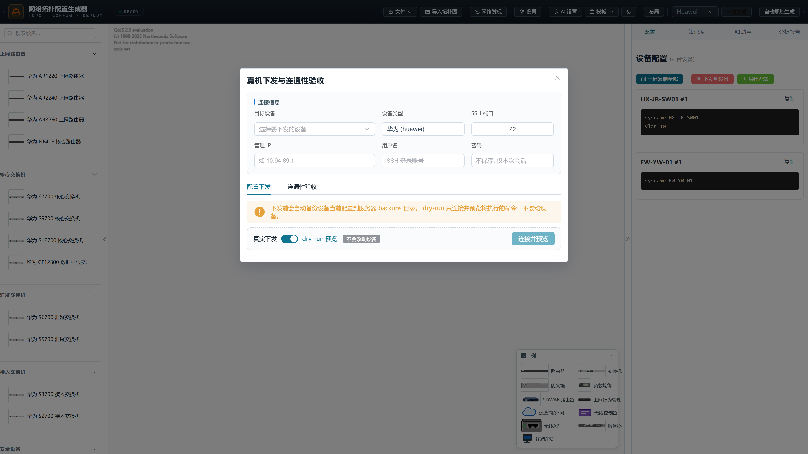

# 网络拓扑配置生成器

拖拽式网络拓扑设计与多厂商设备配置一键生成工具，覆盖**设计 → 生成 → 割接下发 → 验收 → 报告**完整闭环。支持 23 家主流网络设备厂商，覆盖交换机、路由器、防火墙的 CLI 配置自动生成。

## 界面预览

**拓扑编辑器** — eNSP 风格实物图标、IP 旁标、链路属性标注、可折叠双面板：


**登录页**（首次启动自动生成随机密码）：


**设备属性编辑** — 单击设备即可编辑型号、厂商、管理 IP、资产信息等 15 项属性：


**全局设置** — NTP/SNMP/AAA/DNS 参数与平台登录密码修改：


**真机下发与连通性验收** — dry-run 预览 / 真实下发（自动备份），并从设备源地址 ping 验证业务网段真实可达：



**网络自动发现** — SSH+LLDP/CDP 扫描现网，扫描完成后按层级渲染拓扑预览图（含设备类别配色 / 管理 IP / SSH 失败标记），确认后一键生成拓扑与诊断报告：


**AI 助手** — 基于当前拓扑上下文的智能问答：


## 功能特性

### 拓扑设计
- **网络自动发现** — 填入种子设备 SSH 账号，通过 LLDP/CDP 邻居表 BFS 递归扫描整网（华为/H3C/思科/锐捷），扫描完成后弹窗内直接渲染**拓扑预览图**（按核心/汇聚/接入层级自动排布，设备按类别配色，SSH 采集失败节点红框标记），并输出诊断报告（SSH 不可达 / 单链路风险 / 命名冲突 / LLDP 配置缺陷等），一键应用到画布
- **拖拽绘制** — 从设备工具箱拖拽设备到画布，端口连线自动匹配
- **模板系统** — 内置中小型三层架构、园区网、等保合规、Spine-Leaf 等 5 种拓扑模板
- **拓扑图导入** — 支持从拓扑图片（JPG/PNG/BMP/WebP）AI 识别并自动生成拓扑，自动识别设备类型、管理 IP、链路属性与业务分区
- **拓扑图导出** — 支持导出为 PNG 高清、JPEG、SVG 矢量图，自动合成图例卡片
- **自动布局** — 一键自动排列设备，采用层次化布局算法，自动生成安全域分区框
- **导入/导出** — 拓扑文件 JSON 格式导入导出，支持版本管理
- **可折叠面板** — 左侧设备库、右侧配置面板均可一键收起/展开

### 配置生成
- **多厂商支持** — Huawei、Cisco、H3C、Juniper、Arista、HPE、Ruijie、ZTE、Extreme、Dell、Sonic、Maipu、Hikvision、Tplink、Fiberhome、Dptecn、Inspur、Boda、Raisecom、Dcn、NSFocus、Sangfor、QiAnXin
- **一键生成** — 基于拓扑结构和厂商模板引擎，自动生成完整设备配置
- **子网规划** — 自动 VLAN 子网规划与 IP 分配
- **高级协议** — 支持 OSPF 动态路由、VRRP 冗余热备、ACL 访问控制策略自动生成
- **全局设置** — NTP 服务器、SNMP 共同体、AAA 管理账户、DNS 域名等全局参数统一配置

### 查看与导出
- **配置面板** — 按设备分块展示，支持复制、差异对比、历史版本回溯
- **导出格式** — 单文件 .txt / 每设备独立 .cfg / Zip 压缩包（含 topology.json）
- **CLI 终端** — 内置设备命令行模拟器，可直接在设备上执行命令并回写配置

### 真机下发与验收
- **配置下发** — 通过 SSH（netmiko）将生成的配置推送到真实设备，支持华为/H3C/思科/锐捷；默认 **dry-run 预览**模式（只连接并回显将执行的命令，不改动设备），真实下发前强制二次确认
- **CLI 语系预检** — 下发前按厂商 CLI 语法校验命令批次，跨厂商命令自动拦截（ok/error/warn 三级分类），避免误下发
- **批量下发** — 多设备队列式批量推送（SSE 实时进度），适合整网割接场景
- **自动备份与回滚** — 每次下发前自动备份设备当前配置，支持选择历史版本一键回滚；任意两个备份版本可**逐行 diff 配置漂移对比**（新增/删除高亮）
- **Console 初始化** — 新设备 SSH 不可达时，按厂商生成 Console 口初始化命令（主机名/管理地址/SSH/AAA/LLDP/网关/保存），Console 配好即可进入自动发现与远程管理闭环
- **逃生口检测** — 下发前扫描命令批次，自动拦截"自断管理通道"的危险配置（undo SSH/删本地用户/关 VLANIF/接口 shutdown 等），弹窗二次确认
- **变更摘要** — dry-run 预览顶部按类别统计本次变更（VLAN/接口/路由/安全/管理各几条），一屏看清动了什么
- **一键巡检** — 批量 SSH 采集全部设备 CPU/内存/版本/接口概览，表格化展示（阈值超标红色高亮），原始输出可展开排查
- **连通性验收** — 下发完成后可从设备指定源地址（VLANIF/管理口）ping 一组业务目标（DHCP 服务器、网关等），输出 PASS/FAIL 验收表格——验证的是业务网段真实可达，全绿才算"真的通"
- **验收报告导出** — 验收结果一键导出 **Markdown / Word / PDF** 三种格式，直接归档交付
- **割接方案导出** — 一键生成《割接方案》文档（概述/拓扑图/设备清单/命令明细/回退方案/验收项/签字页七章结构），支持 **Word / PDF / Markdown** 三种格式
- **操作审计** — 所有下发/回滚/验收/登录操作自动记录审计日志：SQLite 落库 + JSON Lines 双写，自动记录操作者 IP 与会话标识；平台内置**审计日志面板**（按动作/结果/主机/关键字/时间范围筛选，分页浏览 + 近 7 天操作统计），支持一键导出 CSV 归档
- **登录防爆破** — 同源连续 5 次密码失败自动锁定 10 分钟
- **命令过滤** — 自动剔除注释行、告警横幅等无效行，仅下发有效配置命令

### 辅助功能
- **知识库** — 多厂商命令参考手册
- **AI 助手** — 基于拓扑上下文的智能问答
- **分析报告** — 拓扑校验告警与安全建议
- **设备台账** — 每台设备 15 项属性（型号/厂商/管理 IP/序列号/位置/维护人等）可视化编辑
- **暗色模式** — 支持日间/夜间主题切换，偏好持久化

## 登录与密码

平台采用**单密码登录**，所有 `/api` 接口需要会话 token：

- **首次启动**：若 `backend/.env` 中没有 `APP_PASSWORD`，后端自动生成 12 位随机密码，**打印在后端启动日志中**并写入 `backend/.env`
- **修改密码**：登录后打开【设置 → 全局参数设置 → 平台登录密码】，输入原密码与新密码即可（新密码至少 8 位，写回 `.env`，当前会话不受影响）
- 代码中不保存任何硬编码密码；`.env` 已被 `.gitignore` 排除，不会提交到仓库

## 技术架构

```
topology-config-tool/
├── backend/
│   ├── main.py                 # FastAPI 入口，API 路由
│   ├── kb_engine.py            # 多厂商知识库模板引擎（23 厂商命令语法）
│   ├── config_generator.py     # AI 配置生成（DeepSeek API）
│   ├── vision_analyzer.py      # 拓扑图视觉分析（Qwen-VL / DashScope）
│   ├── network_scanner.py      # 网络自动发现（SSH+LLDP/CDP BFS 递归扫描）
│   ├── device_connector.py     # 真机连接器（netmiko 多厂商 SSH 下发/备份/ping 验收）
│   ├── console_init.py         # Console 初始化命令模板（华为/H3C/思科/锐捷）
│   ├── change_plan.py          # 割接方案文档生成（python-docx 七章结构）
│   ├── report_export.py        # 验收报告/割接方案导出（MD/DOCX/PDF）
│   ├── audit.py                # 操作审计模块（SQLite + JSONL 双写，过滤/分页/统计/CSV 导出）
│   ├── chat.py                 # AI 对话
│   ├── prompts.py              # Prompt 模板
│   ├── knowledge_base/         # 厂商命令模板库（20 个 JSON）
│   └── requirements.txt
├── frontend/
│   ├── src/
│   │   ├── App.vue             # 主应用（布局、工具栏、状态管理）
│   │   ├── main.js             # Vue 入口
│   │   ├── components/         # 15 个核心组件（编辑器/发现/下发/识图/AI 等）
│   │   ├── topology/           # 拓扑逻辑（设备定义、连线规则、模板工厂等）
│   │   └── utils/              # 工具函数（diff 算法等）
│   ├── package.json
│   └── vite.config.js
├── .env.example                # 环境变量模板
├── .gitignore
├── setup.bat                   # 一键安装+启动（推荐）
├── start.bat                   # 快速启动（跳过安装步骤）
├── restart.bat                 # 重新构建前端并重启后端
└── build.bat                   # 仅构建前端
```

**前端**：Vue 3 (Composition API) + Vite + Element Plus + GoJS 2.3  
**后端**：FastAPI + DeepSeek API + DashScope Qwen-VL  
**运行端口**：`http://localhost:5732`

## 快速开始

### 环境要求
- Python 3.8+
- Node.js 18+
- DeepSeek API Key（必需）
- DashScope API Key（可选，拓扑图识别功能需要）

### 1. 克隆项目

```bash
git clone <repo-url>
cd topology-config-tool
```

### 2. 配置 API Key

```bash
cp .env.example backend/.env
# 编辑 backend/.env，填入你的 API Key
```

```env
DEEPSEEK_API_KEY=sk-your-deepseek-key-here

# 可选：拓扑图图片识别
DASHSCOPE_API_KEY=sk-your-dashscope-key-here
DASHSCOPE_BASE_URL=https://dashscope.aliyuncs.com/compatible-mode/v1
VISION_PROVIDER=dashscope
VISION_MODEL=qwen-vl-max
```

### 3. 安装依赖

**后端**：
```bash
cd backend
python -m venv venv
venv\Scripts\activate        # Windows
# source venv/bin/activate   # macOS / Linux
pip install -r requirements.txt
```

**前端**：
```bash
cd frontend
npm install
```

### 4. 启动服务

**方式一：一键启动（推荐）**
```
双击 setup.bat
```
自动完成：创建虚拟环境 → 安装依赖 → 检查配置 → 构建前端 → 启动服务

**方式二：手动启动**
```bash
# 终端 1 — 前端构建 + 后端
cd frontend && npm run build && cd ../backend && python main.py

# 终端 2 — 前端开发模式（可选，热更新）
cd frontend && npm run dev
```

### 5. 访问

浏览器打开 `http://localhost:5732`

> **首次启动的登录密码**在后端启动日志中打印（形如 `首次启动已生成随机登录密码: xxx`），也可查看 `backend/.env` 中的 `APP_PASSWORD`；登录后可在【设置 → 全局参数设置】中修改。

## 使用指南

### 基本流程
1. 从左侧设备工具箱拖拽设备到画布（可按厂商筛选）
2. 鼠标悬浮设备端口，拖拽到另一设备端口完成连线
3. 右键链路可配置 VLAN、Eth-Trunk 等参数
4. 选择目标厂商，点击「一键生成全部配置」
5. 右侧面板查看、复制或导出配置

### 工具栏说明
| 按钮 | 功能 |
|------|------|
| 文件 | 下拉菜单：保存拓扑 / 加载拓扑 / 导出图片 PNG·JPEG·SVG / 清空画布 |
| 导入拓扑图 | 从拓扑图片 AI 识别生成拓扑 |
| 网络发现 | SSH+LLDP/CDP 扫描现网，自动生成拓扑预览与诊断报告 |
| 设置 | 全局参数（NTP、SNMP、AAA、登录密码等） |
| AI 设置 | 配置 AI 对话/识图模型接口 |
| 模板 | 从预设拓扑模板快速创建 |
| 布局 | 一键自动排列设备（层次化布局） |
| 厂商 | 选择目标厂商后一键生成配置 |
| 一键生成 / 自动规划生成 | 按画布拓扑生成全部设备配置（后者先自动划分子网/VLAN/DHCP） |

### 配置下发流程（真机操作）
1. 生成配置后，在右侧配置面板点击【下发到设备】
2. 选择目标设备、填写管理 IP 与 SSH 账号（密码仅本次会话使用，不保存）
3. 保持 **dry-run 预览**开启，点击"连接并预览"确认将执行的命令——此时不会改动设备
4. 关闭 dry-run，二次确认后真实下发（下发前自动备份设备当前配置）
5. 切到【连通性验收】标签，填源地址与目标列表，跑 ping 验收——全绿才算"真的通"

### 右键菜单
- **设备**：打开命令行、编辑属性、复制设备、导出配置、删除
- **链路**：编辑 VLAN/端口配置、删除
- **画布**：粘贴设备、导出为图片、清空

## API 接口

| 方法 | 路径 | 说明 |
|------|------|------|
| POST | `/api/auth/login` | 平台登录，返回会话 token |
| POST | `/api/auth/change-password` | 修改平台登录密码（需登录） |
| GET / POST | `/api/settings` | 获取 / 保存全局设置 |
| POST | `/api/settings/test` | 测试 AI 接口连通性 |
| POST | `/api/generate` | 生成设备配置（AI） |
| POST | `/api/generate/kb` | 纯知识库生成配置（不使用 AI） |
| POST | `/api/analyze/topology-image` | 拓扑图视觉分析 |
| POST | `/api/discover/stream` | 网络自动发现（SSE 进度流，LLDP/CDP 递归扫描） |
| POST | `/api/device/push` | 真机配置下发（netmiko SSH，支持 dry-run 与自动备份） |
| POST | `/api/device/push-batch` | 批量下发（SSE 实时进度） |
| POST | `/api/device/backups/diff` | 两个备份版本配置漂移对比 |
| GET | `/api/device/backups` | 查询设备历史备份版本 |
| POST | `/api/device/rollback` | 回滚到指定备份版本 |
| GET | `/api/audit` | 最近审计记录（兼容旧接口） |
| GET | `/api/audit/query` | 审计条件查询（动作/结果/主机/关键字/时间范围+分页） |
| GET | `/api/audit/actions` | 审计动作类型统计 |
| GET | `/api/audit/stats` | 近 N 天操作统计（趋势/分布/失败数） |
| GET | `/api/audit/export` | 审计日志导出 CSV |
| POST | `/api/console-init` | 生成 Console 初始化命令（四厂商） |
| POST | `/api/export/acceptance-report` | 导出验收报告（format=md/docx/pdf） |
| POST | `/api/export/change-plan` | 导出割接方案（format=md/docx/pdf） |
| POST | `/api/device/ping-tests` | 连通性验收（从设备源地址 ping 多目标） |
| POST | `/api/device/state` | 采集设备运行状态 |
| GET | `/api/kb/*` | 知识库检索（厂商/分类/命令） |
| POST | `/api/chat/stream` | AI 助手对话（SSE 流式） |

## 支持的配置命令类型

- **基础**：hostname、VLAN 创建与命名、access/trunk 端口
- **路由**：静态路由、OSPF 动态路由
- **冗余**：VRRP 热备、Eth-Trunk 链路聚合
- **安全**：ACL 访问控制、管理 ACL
- **管理**：NTP、SNMP、AAA、SSH/Telnet
- **其他**：DHCP、端口镜像、生成树、LLDP

## License

MIT
